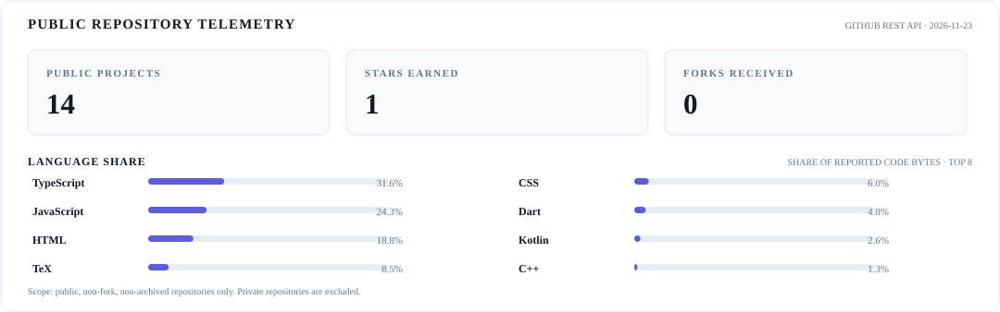

## GitHub telemetry

  <picture>
    <source media="(prefers-color-scheme: dark)" srcset="https://raw.githubusercontent.com/Sahil-Khan-I/Sahil-Khan-I/main/assets/github-telemetry-dark.svg" />
    <source media="(prefers-color-scheme: light)" srcset="https://raw.githubusercontent.com/Sahil-Khan-I/Sahil-Khan-I/main/assets/github-telemetry-light.svg" />
    
  </picture>

Counts are calculated directly from GitHub's public REST API. Scope: public, non-fork, non-archived repositories only. Language percentages represent GitHub's reported code bytes, not time spent coding. Refreshed daily by GitHub Actions. Private repository data is intentionally excluded.

## Contribution map

  <picture>
    <source media="(prefers-color-scheme: dark)" srcset="https://raw.githubusercontent.com/Sahil-Khan-I/Sahil-Khan-I/output/github-snake-dark.svg" />
    <source media="(prefers-color-scheme: light)" srcset="https://raw.githubusercontent.com/Sahil-Khan-I/Sahil-Khan-I/output/github-snake.svg" />
    
  </picture>

  <a href="https://github.com/Sahil-Khan-I/Sahil-Khan-I/actions/workflows/snake.yml">View the data refresh workflow</a>

